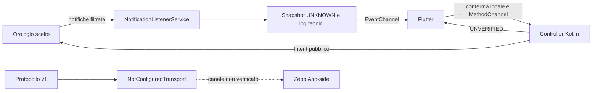

# Componente Android

Data: 16 novembre 2026. Progetto Flutter già inizializzato in `android_alarm_remote/`, conservato senza ricrearlo. Il progetto watch non è stato modificato.

## Componenti e lifecycle

- Flutter Material 3: stato, diagnostica, test locale con conferma e impostazioni. Il ritorno dalle impostazioni aggiorna lo snapshot.
- `MainActivity`: MethodChannel `alarm_remote/native`, EventChannel `alarm_remote/events`; scoperta delle app tramite Intent pubblici e avvio dei comandi soltanto con Activity visibile.
- `AlarmListener`: NotificationListenerService gestito dal sistema. Aspetta `onListenerConnected`, riconcilia le notifiche attive e filtra il pacchetto scelto prima di ispezionare metadati. Gestisce aggiornamenti, rimozioni, disconnessione e ricreazione.
- `AlarmEvidence`: seleziona categoria `alarm`, esclude riepiloghi. Categoria, ongoing e fullscreen non sono prova di suoneria: lo stato rimane UNKNOWN. Nessun testo o titolo viene letto, nessuna etichetta delle azioni viene interpretata.
- `AlarmRepository`: occorrenze con UUID per ciascuna nuova notifica dopo rimozione; massimo 32 candidate, 16 rimozioni e 100 log in memoria. La scelta del pacchetto è persistita in SharedPreferences; notifiche, chiavi interne e log non sono persistiti. Alla disconnessione invalida le occorrenze.
- Controller: solo Intent AlarmClock standard verso il pacchetto scelto, dopo riconciliazione e conferma umana di suoneria. Rifiuta più candidate, occorrenza non corrente, Activity non visibile e listener assente. Una candidata viene consumata prima dell'avvio per evitare doppi comandi nella stessa sessione. Esiti FAILED / UNSUPPORTED / UNVERIFIED; mai EXECUTED senza verifica autorevole.
- `protocol.dart`: parser compatibile con il protocollo v1 Zepp, adapter `NotConfiguredTransport`, guardia di sessione con correlazione, cache 128, deadline 8 secondi, limiti età 10 secondi/passaggio futuro 5 secondi, invalidazione dopo disconnessione e isolamento delle risposte tardive.

## Limiti deliberati

Non viene emesso ALARM_RINGING o ALARM_STOPPED: la presenza/rimozione di una notifica non basta a confermare suoneria/cessazione. Il test manuale permette all'utente di provare l'Intent con un'indicazione chiara dell'incertezza. Non selezioniamo PendingIntent da etichette, né chiamiamo azioni con semantica non verificata. Nessun adapter reale usa la guardia Dart: prima di collegarlo servono registro persistente con TTL, riconciliazione autorevole, autenticazione del canale e test di timeout con azione nativa già avviata. Dopo riavvio non esiste replay; la stessa notifica potrebbe ottenere un nuovo UUID, limite da risolvere prima dei comandi remoti.

La UI e i test locali funzionano senza Zepp. Nessun foreground service, receiver di boot, server localhost, BLE diretto o AccessibilityService. Il listener viene associato dal sistema previa autorizzazione, ma non garantisce disponibilità continua in HyperOS. Nessun successo end-to-end dichiarato.
