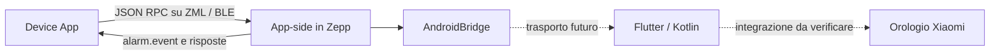

# Architettura — fase Zepp OS

Progetto esistente preservato in `amazfit-alarm-remote/`. Root riservata alla monorepo e alla documentazione. Il componente Flutter/Kotlin è ora nel progetto preesistente `android_alarm_remote/`: vedere [ANDROID_ARCHITECTURE.md](ANDROID_ARCHITECTURE.md). Il trasporto verso questo componente resta non configurato.

## Componenti implementati

- `app.js`: registra `BaseApp`, che gestisce lifecycle e canale Bluetooth ZML.
- `page/index.js`: UI ufficiale `@zos/ui`, layout circolare scalato da 466×466. Registra `BasePage`, gestisce gli eventi ZML, heartbeat e teardown.
- `shared/alarm-machine.js`: logica indipendente dalle API Zepp; nessun accesso alla UI o al Bluetooth.
- `shared/protocol.js`: schema JSON versionato, identificativi e validazione condivisibili con Android.
- `shared/android-bridge.js`: verifica risposte, scadenza e deduplicazione dei comandi; adapter Android esplicitamente non configurato.
- `app-side/index.js`: `BaseSideService` eseguito dentro Zepp sul telefono, non dentro la futura app Android. RPC `alarm.status`, `alarm.command`; inoltro `alarm.event` tramite subscription dell'adapter.
- `setting/index.js`: impostazioni Zepp persistenti in `settingsStorage`, con preferenza posticipo nativo esplicitamente futura e diagnostica senza dati personali.

La sola dipendenza runtime aggiunta è `@zeppos/zml` 0.0.43, libreria ufficiale: [repository Zepp Health](https://github.com/zepp-health/zml). Le API utilizzate sono state confrontate anche con esempi e dichiarazioni distribuiti nel pacchetto npm. `@zeppos/device-types` resta una dipendenza di sviluppo, non un runtime da installare sull'orologio.

## Flusso

Il bridge di produzione attuale riporta `androidAvailable: false`; non genera sveglie simulate, non contatta endpoint e non conferma mai un comando eseguito. L'iniezione di un trasporto nei test serve esclusivamente a verificare la logica.

## Stati e transizioni consentite

| Origine | Evento/condizione | Destinazione |
| --- | --- | --- |
| Iniziale / qualsiasi | Canale perso, Android indisponibile nell'heartbeat | DISCONNECTED; richiesta e sveglia locali invalidate |
| DISCONNECTED | Canale operativo confermato | IDLE; attende un nuovo evento sveglia |
| IDLE, RINGING, ERROR, stati terminali | ALARM_RINGING valido, recente, canale operativo | RINGING |
| RINGING / ERROR con sveglia e canale | Comando esplicito utente | SENDING_COMMAND |
| SENDING_COMMAND | Invio al trasporto | WAITING_CONFIRMATION, fase SENT |
| SENDING_COMMAND / WAITING_CONFIRMATION | Ricezione risposta correlata | WAITING_CONFIRMATION, fase RECEIVED |
| Richiesta pendente | Risposta corretta EXECUTED | DISMISSED oppure SNOOZED |
| Richiesta pendente | Timeout / errore / conferma incompatibile | ERROR |
| Sveglia attiva | ALARM_STOPPED corrispondente | IDLE |
| Richiesta pendente | Nuova sveglia differente | RINGING; richiesta precedente invalidata |
| DISMISSED / SNOOZED | Tick successivo (entro circa 1 s) | IDLE |
| Qualsiasi | Messaggio non valido | ERROR senza confermare alcuna azione |

Gli eventi duplicati, quelli temporalmente precedenti e le conferme di richieste non più pendenti sono ignorati. Una nuova sveglia e le sveglie terminate sono isolate tramite `alarmId`; lo snooze successivo deve avere un nuovo ID di occorrenza. Un evento ripetuto della stessa sveglia non annulla un comando in corso. Le memorie di deduplicazione della macchina sono limitate a 128 elementi; non sono un registro persistente.

La UI controlla `enabled` prima di ogni azione, compresi i tap su pulsanti attenuati: non basta il colore. Nessun retry automatico del comando. Dopo una disconnessione è necessario un nuovo evento/snapshot autorevole, non viene riprodotta una vecchia azione. L'implementazione della riconciliazione dello snapshot appartiene al futuro adapter.

## Connessione e lifecycle

Heartbeat `alarm.status` ogni 5 s soltanto a pagina aperta, timeout locale 4 s, lease di contatto 12 s. Il timeout comando è 10 s; il bridge attende l'adapter al massimo 8 s. Bluetooth connesso non significa Android raggiungibile. Gli eventi di disconnessione provengono da `BasePage.onBleChanged`, evitando di sostituire il listener BLE già gestito da ZML. Gli intervalli e gli handler vengono chiusi nel teardown; le risposte tardive vengono scartate per generazione/correlazione.

Non viene dichiarato un App Service in background. Per questo, uscendo dalla Mini App non si mantiene un ricevitore residente. Non sono state richieste autorizzazioni background o notifiche che questa fase non utilizza.

Fonti: [BLE Device App](https://docs.zepp.com/docs/v2/reference/device-app-api/newAPI/ble/), [Messaging App-side](https://docs.zepp.com/docs/v2/reference/side-service-api/messaging/), [architettura ufficiale](https://docs.zepp.com/docs/1.0/guides/architecture/arc/).
